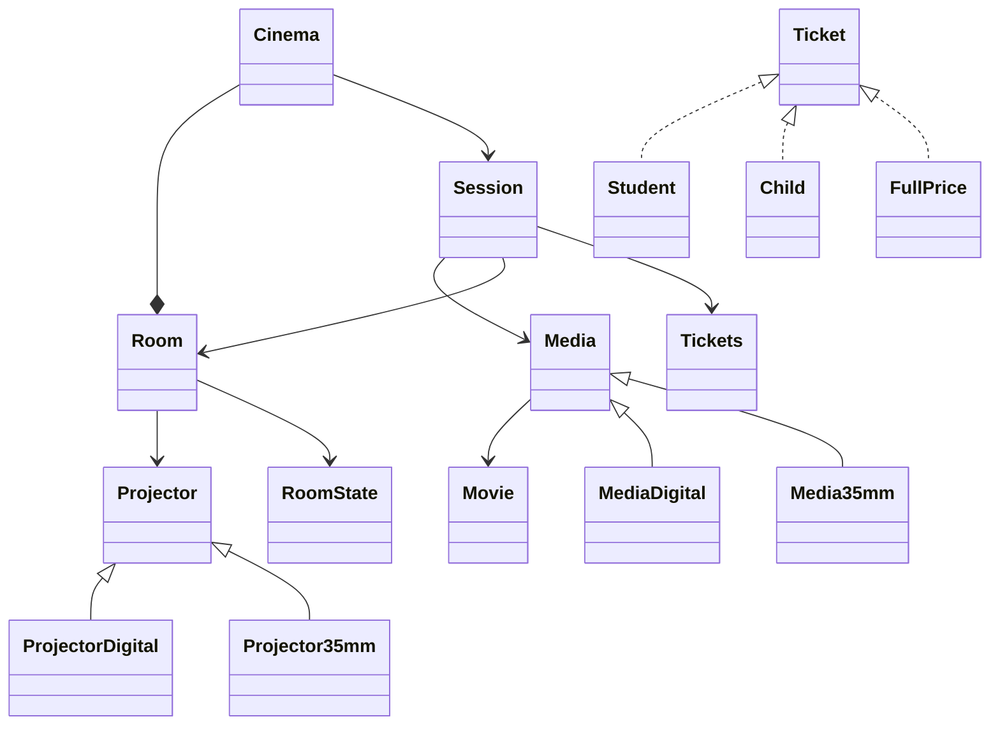

## Room
Create Room -> ID, capacity and its **projector**.
Can be READY, IN_SESSION or IN_CLEANING.

## Projector
Create Projector -> 2 possiblity -> Digital or Film
Must be either Digital or Film
Link with **Room**

## Movie
Create Movie -> Title, duration(minutes)

## Media
Create a Media
Sent on 2 **media** possible formats -> Digital or 35mm(Film)
Make link with the **projector** on media and **Movie**

## Ticket
Create a ticket -> 3 types -> Full price, Student or Child.
Student -> -25% discount
Child -> 5€ fixed price

## Cinema
Schedule a **session**
Refuse a room that is not its own.

## Session
Create a session -> room ID, media, date and the price.

