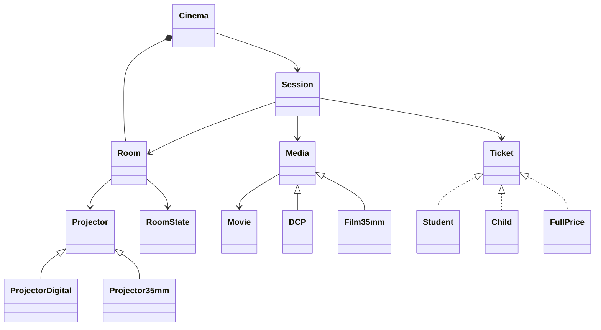

# Domain Entities

## Room
- Attributes : ID, Capacity, **projector**, state(**RoomState**)
- Rules:
    - Can only start if **READY** in state
    - Ending a session automatically transistions the states to **IN_CLEANING**
    - Transistions back to **READY** only when cleaning is done
- Enum : **RoomState** (READY, IN_SESSION, IN_CLEANING)

## Projector (Abstract)
- Attributes : Serial Number(ID)
- Subtypes: **ProjectorDigital**, **Projector35mm**

## Movie
- Attributes : Title, duration (minutes)

## Media (Abstract)
- Reference a **Movie**
- Subtypes:
    - **DCP** : Read-only by Digital **Projector**, invalid if screening date > key expiration date
    - **Film35mm** : Read-only by 35mm **Projector**, invalid if number of projection reaches 50 

## Ticket (Interface)
- Compute price based on session base price:
    - **FullPrice**: 100% of base price
    - **Student**: 25% discount
    - **Child**: 5€ fixed price

## Cinema (Composition)
- Owns Room and schedule sessions
- Rules: 
    - Schedules sessions (reject any room not belonging to Cinema)
    - Compute total daily revenue

## Session
- Attributes : Room, Media, date, base price, list of tickets
- Responsabilities:
    - Validate room avaibility (**RoomState**) and **Media** compability before starting a session
    - Compute remaining seats, occupancy rate and session revenue

# Class Diagram

# Business Behaviors

- Schedule a session: Plan a movie screening on a specific media, in a designated room belonging to the Cinema, at a given date and base price. Refuse if the room does not belong to the Cinema
- Sell a Ticket: Issue an entrance ticket for a session. Refuse if the room is already full
- Start a session: Launch the screening. Refuse if the room is not READY or format incompatible with the projector or if the DCP key is expired
- End a session: Conclude the screening. Automatically moves the room to IN_CLEANING and increment counters if Film35mm copies
- Finish Cleaning: Confirm the room is clean. Move room state to READY. Refuse if the room is not IN_CLEANING
- Compute remaing seats & occupancy: Real-time metrics computed directly by the session from its room capacity and sold tickets count
- Compute revenue: Sum of sold tickets prices computed by the sessions and by the cinema of the entire day